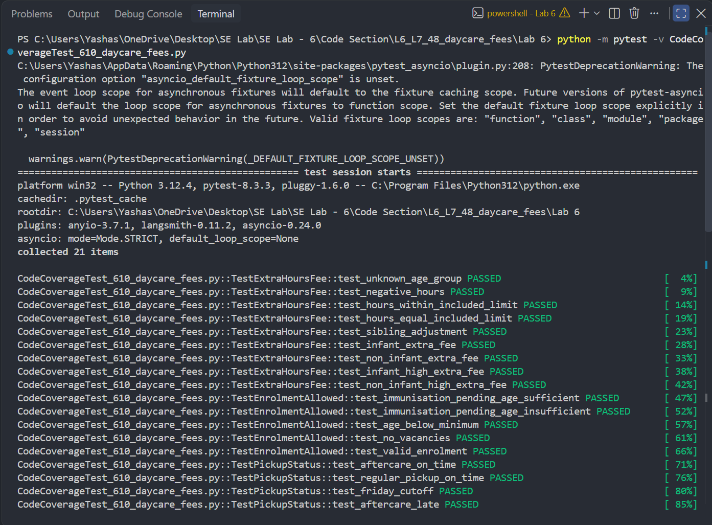
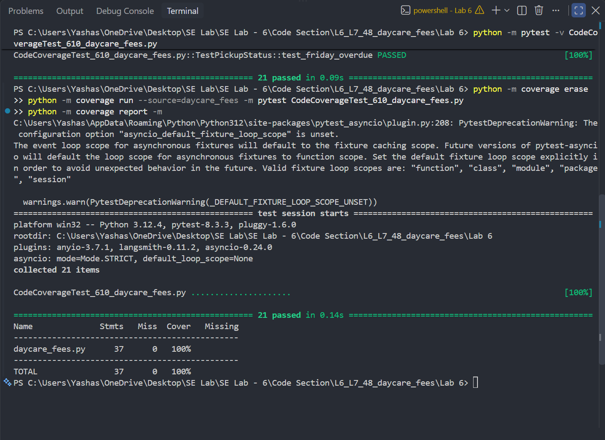
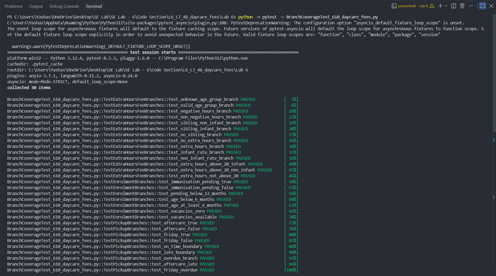
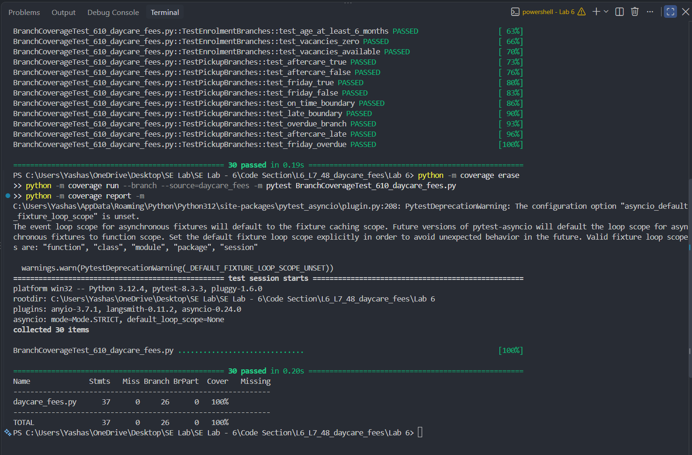

# Daycare Fees — Code & Branch Coverage

A focused software-testing exercise for the daycare fee and enrolment rules implemented in `daycare_fees.py`. This repository contains the original module, the starter tests, two expanded test suites, and terminal evidence for statement and branch coverage.

> **Lab:** SE Lab 6 · Code and Branch Coverage Analysis  
> **Language:** Python  
> **Test framework:** pytest  
> **Coverage tool:** coverage.py

## What is being tested?

The module exposes three functions:

| Function | Behaviour covered |
|---|---|
| `extra_hours_fee(age_group, hours, has_sibling)` | Validates age groups and hours, applies included-hour allowances and sibling discounts, and calculates extra-hour fees. |
| `enrolment_allowed(age_months, vacancies, is_immunisation_pending)` | Evaluates enrolment eligibility using age, vacancy availability, and immunisation status. |
| `pickup_status(minutes_left, is_aftercare, is_friday)` | Classifies pickup as on time, late, or overdue using the applicable cutoff. |

The implementation under test is kept separate from the additional test suites. The coverage work adds tests; it does not change the application logic.

## Repository layout

```text
.
├── daycare_fees.py
├── test_daycare_fees.py
├── CodeCoverageTest_610_daycare_fees.py
├── BranchCoverageTest_610_daycare_fees.py
├── screenshots/
│   ├── code_coverage_1.png
│   ├── code_coverage_2.png
│   ├── branch_coverage_1.png
│   └── branch_coverage_2.png
├── .gitignore
└── README.md
```

| File | Purpose |
|---|---|
| `daycare_fees.py` | Application module being tested |
| `test_daycare_fees.py` | Starter tests supplied with the lab |
| `CodeCoverageTest_610_daycare_fees.py` | Expanded tests for statement/code coverage |
| `BranchCoverageTest_610_daycare_fees.py` | Tests designed to exercise decision outcomes and branches |
| `screenshots/` | Terminal evidence from the coverage runs |

## Run locally

Use Python 3 and run the following commands from the repository root.

### 1. Install the test and coverage tools

```bash
python -m pip install pytest coverage
```

### 2. Run the code coverage suite

```bash
python -m coverage erase
python -m coverage run --source=daycare_fees -m pytest CodeCoverageTest_610_daycare_fees.py
python -m coverage report -m
```

**Recorded result:** 21 tests passed · **100% statement coverage**.

### 3. Run the branch coverage suite

```bash
python -m coverage erase
python -m coverage run --branch --source=daycare_fees -m pytest BranchCoverageTest_610_daycare_fees.py
python -m coverage report -m
```

**Recorded result:** 30 tests passed · **100% branch coverage**.

The two suites are run separately so that each coverage result is measured independently.

## Coverage evidence

The screenshots below are the terminal evidence captured for the two runs.

### Code coverage





### Branch coverage





## Notes

- Coverage percentages refer to `daycare_fees.py`, measured by coverage.py.
- Statement coverage and branch coverage are different measurements; the branch run uses the `--branch` option.
- The results above reflect the recorded local test runs. Re-run the commands in your environment to reproduce them.

---

**SE Lab 6 · Code and Branch Coverage Analysis**
